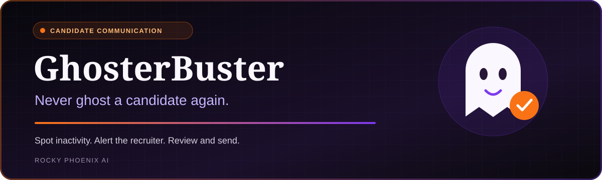
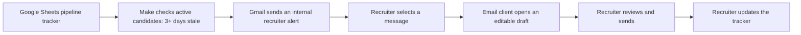
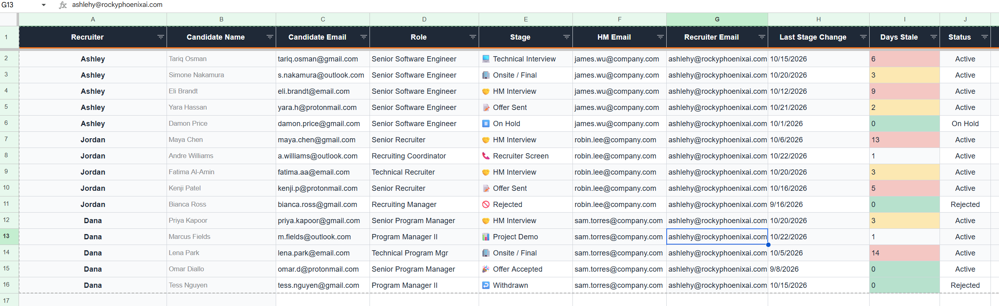
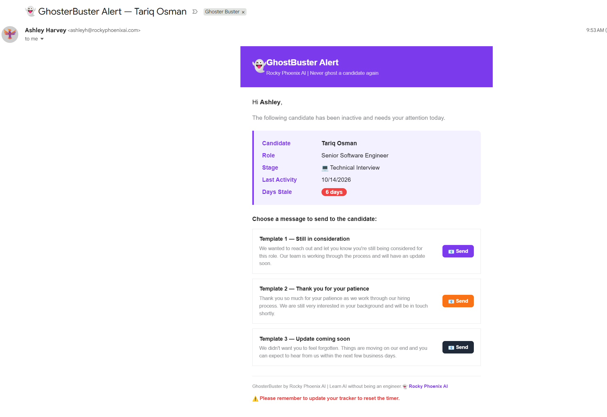
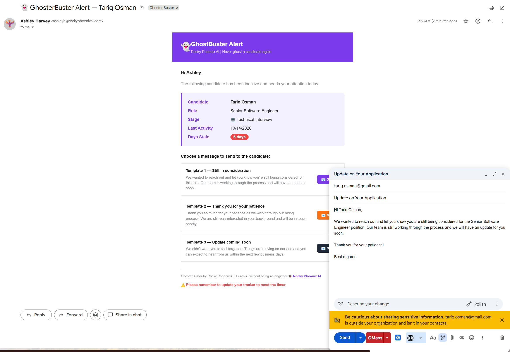
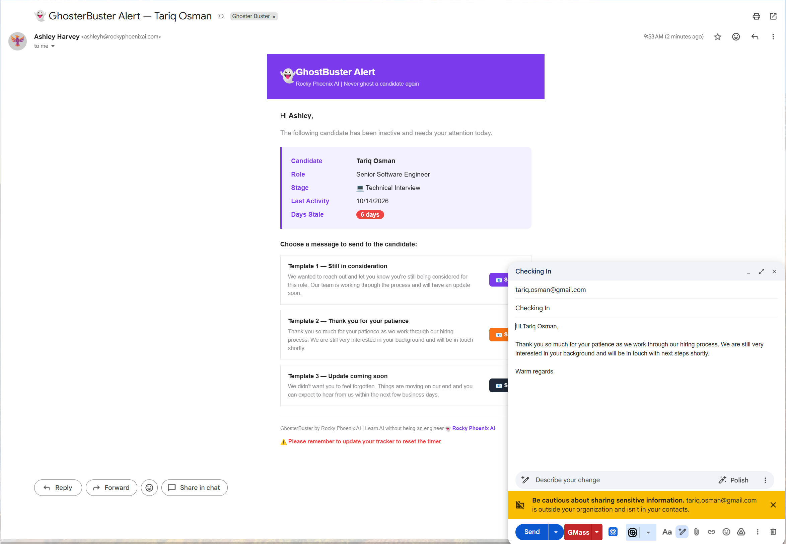
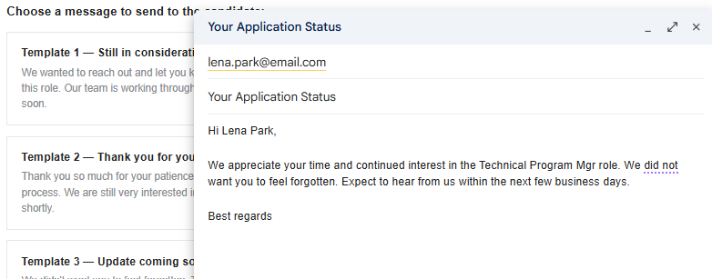
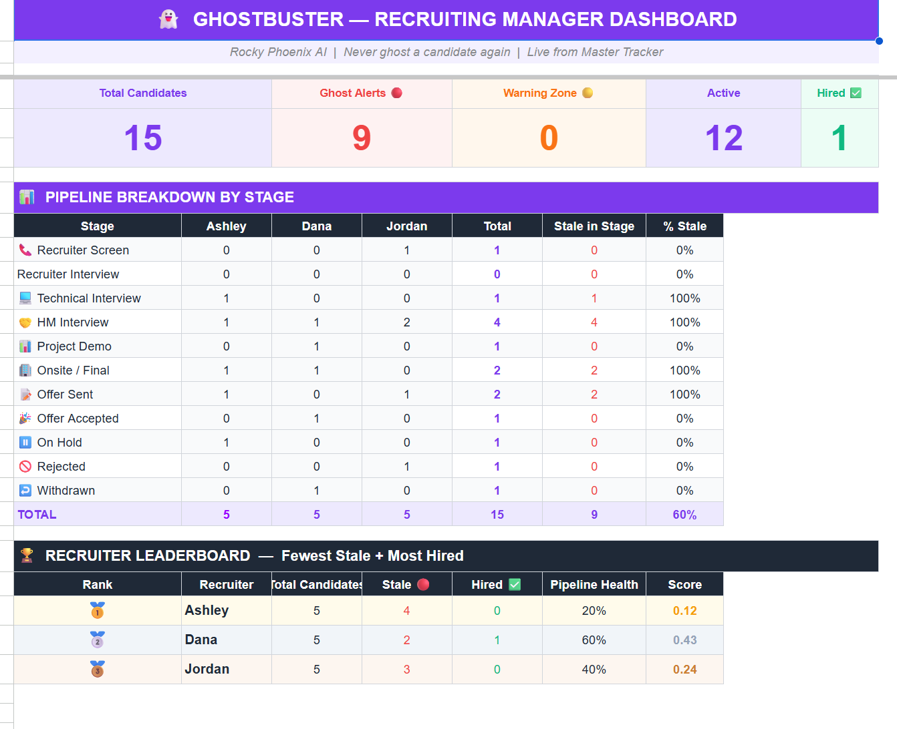

 

## Never ghost a candidate again

**GhosterBuster helps recruiting teams spot stale candidates and follow through with a thoughtful update.** A color-coded tracker makes inactivity visible. A scheduled automation sends an internal alert with candidate context and three follow-up options. The recruiter chooses a message, reviews it, and sends it from their email client.

**[Watch the GhosterBuster demo video →](./media/ghosterbuster-demo.mp4)**

The Canva video is included in this repository. Open the link to view or download the MP4.

## The challenge

Hiring processes slow down. Interview feedback takes longer than expected, priorities shift, and candidates can go days without hearing what happens next. Recruiters need a clear reminder and an easy next action to keep communication moving.

## The workflow

### 1. See who needs attention

The tracker brings recruiter ownership, candidate, role, stage, last stage change, days stale, and status into one view. Color cues help the recruiter spot records that need attention.

### 2. Receive an actionable alert

The alert includes the candidate's role, stage, last activity, and days stale, with three message options in the same email.

### 3. Review a candidate-ready message

| Message | When to use it |
|---|---|
| **Still in consideration** | The candidate remains in the process while the team works through next steps. |
| **Thank you for your patience** | The recruiter wants to acknowledge a delay and confirm continued interest. |
| **Update coming soon** | The recruiter can commit to providing an update within the next few business days. |

The buttons open prefilled, editable emails using `mailto:` links. **The recruiter reviews the recipient, wording, and commitments before sending.**

<strong>View the three candidate email examples</strong>

#### Still in consideration

#### Thank you for your patience

#### Update coming soon

### 4. Give recruiting managers a pipeline view

The recruiting manager dashboard brings total candidates, ghost alerts, the warning zone, active candidates, and hires into one view. A stage breakdown shows how candidates are distributed across recruiters and where records are stale. The recruiter leaderboard displays stale counts, hires, pipeline health, and a summary score.

These are the values shown in the captured dashboard, rather than measured improvements from using the tool. The screenshot demonstrates the manager view; the scoring formula is not included in this repository.

## Built with

| Tool | Purpose |
|---|---|
| **Google Sheets** | Pipeline tracker, stale-record data, and recruiting manager dashboard |
| **Make** | Scheduled search for active candidates with three or more days stale |
| **Gmail** | Internal HTML alert with candidate context and follow-up options |
| **Recruiter's email client** | Editable candidate message and final send |

## What is automated—and what needs a person

The verified workflow searches the tracker and sends internal alerts. Candidate messages use predefined templates populated with candidate and role details. There is no language-model step in this workflow.

The recruiter remains responsible for the message and the final send. After following up, they update the tracker to reset the timer. The tracker is the source of the stale-day value; the automation does not inspect sent mail to determine whether contact occurred.

The current configuration sends alerts to one configured internal inbox. Per-recruiter routing would require an additional configuration change.

## Why it matters

- Makes candidate communication gaps easier to see.
- Gives recruiting managers visibility into stale records by stage and recruiter.
- Gives the recruiter a specific next action inside the reminder.
- Reduces the effort of starting a follow-up email.
- Keeps ownership and final communication with the recruiter.

## Repository scope

This is a portfolio case study of the working workflow, with a demo and screenshots. It does not contain an installable application or an importable Make blueprint. See the [workflow notes](./docs/workflow.md) for the verified logic and implementation boundaries.

---

**Built by Ashley Harvey · Rocky Phoenix AI**  
Practical automation. Thoughtful candidate communication.
